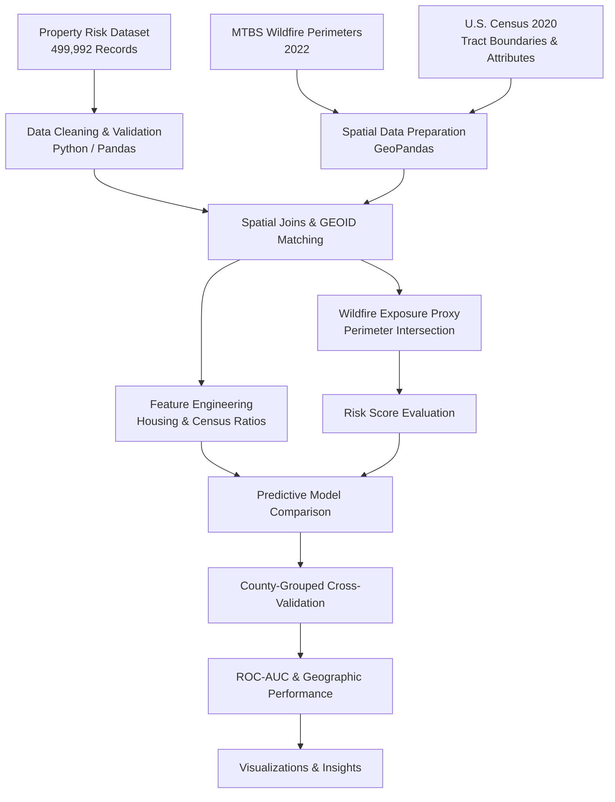
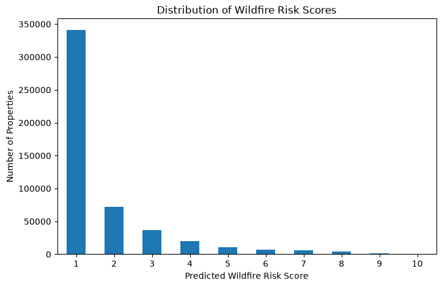
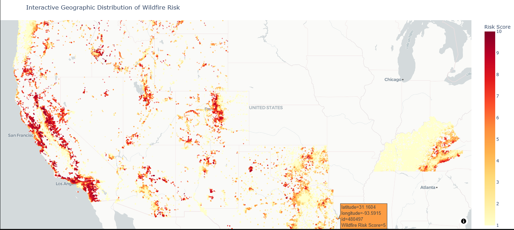

#  Wildfire Risk & Geospatial Analysis

**Python | Pandas | GeoPandas | Scikit-learn | U.S. Census | Machine Learning**

A geospatial data analytics project evaluating wildfire risk predictions across **499,992 U.S. property locations** using historical wildfire perimeters, Census tract enrichment, spatial analysis, and geographic model validation.

##  Project Overview

How reliable are existing wildfire risk scores, and can additional geographic and demographic data improve their predictive performance?

This project evaluates pre-existing 2022 wildfire risk scores (1–10) by integrating external wildfire perimeter data and U.S. Census information.

The project focuses on:
- Evaluating existing wildfire risk predictions
- Identifying geographic patterns and wildfire exposure
- Integrating multiple spatial and tabular datasets
- Engineering Census-derived housing features
- Comparing predictive approaches using geographic cross-validation
- Communicating findings through data visualization

> **Data disclosure:** Property-level risk scores and Census attributes were provided for a technical assessment and are not redistributed. This project evaluates the supplied risk scores; it does not claim to have developed the original risk model.

##  Project Architecture



##  Analytical Questions

1. How are existing wildfire risk scores distributed across properties and regions?
2. How well do risk scores distinguish properties intersecting mapped wildfire perimeters?
3. How does performance change when evaluated within fire-affected counties or nearby locations?
4. Can Census tract information enrich the property dataset?
5. Do additional Census-derived features improve predictive performance?

##  Data Sources

| Dataset | Purpose | Access |
|---|---|---|
| Property risk dataset | Property coordinates and existing 2022 risk scores | Assessment-provided |
| MTBS wildfire perimeters | Historical wildfire exposure analysis | Public |
| U.S. Census 2020 tract boundaries | Geographic enrichment and GEOID matching | Public |
| Census tract attributes | Housing and demographic feature engineering | Assessment-provided |

**Public references:**
- [Monitoring Trends in Burn Severity (MTBS)](https://www.mtbs.gov/)
- [U.S. Census Bureau — Cartographic Boundary Files](https://www.census.gov/geographies/mapping-files/2020/geo/carto-boundary-file.html)

##  Technical Workflow

### 1. Data Exploration and Preparation

- Validated approximately 500K property records.
- Examined missing values, duplicates, and risk score distributions.
- Prepared geographic coordinates for spatial analysis.
- Analyzed existing risk score patterns.

### 2. Geospatial Analysis

- Processed historical wildfire perimeter polygons.
- Aligned coordinate reference systems.
- Performed point-in-polygon spatial joins.
- Identified properties intersecting mapped wildfire perimeters.
- Compared risk discrimination across geographic scales.

### 3. Census Data Enrichment

- Matched properties to Census tract GEOIDs.
- Joined geographic boundaries with tract-level attributes.
- Created normalized housing indicators:
  - Vacancy rate
  - Detached housing share
  - Mobile home share

### 4. Model Evaluation

Compared three feature sets:

1. Existing wildfire risk score
2. Census-derived features
3. Existing risk score combined with Census features

Applied five-fold county-grouped cross-validation and evaluated ROC-AUC to assess geographic generalization.

### 5. Visualization and Interpretation

Used Python visualization libraries to explore risk distributions, geographic exposure, and predictive performance.

##  Key Results

### Wildfire Exposure Analysis

| Metric | Result |
|---|---:|
| Properties analyzed | **499,992** |
| Properties intersecting wildfire perimeters | **920** |
| Perimeter-intersection rate | **0.184%** |
| Wildfire events represented | **33** |
| Counties containing positive cases | **32** |
| Census tract matching rate | **~99.99%** |

### Geographic Risk Evaluation

| Evaluation | ROC-AUC |
|---|---:|
| Overall wildfire risk score | **~0.976** |
| Within fire-affected counties | **~0.951** |
| Within approximately 25-km neighborhoods | **~0.798** |

**Finding:** The original risk score demonstrated strong overall discrimination, but performance declined when evaluated at a more localized geographic level.

This suggests that identifying broadly fire-prone regions is different from accurately ranking nearby properties.

### Predictive Model Comparison

| Feature Set | Mean ROC-AUC | Fold Standard Deviation |
|---|---:|---:|
| **Existing Risk Score Only** | **0.9777** | 0.0092 |
| Census Features Only | 0.7187 | 0.2046 |
| Risk Score + Census Features | 0.7016 | 0.2331 |

**Finding:** The original risk score outperformed the Census-only and combined feature sets in this experiment.

Adding the selected Census features did not improve geographic generalization. The large variation across folds for Census-based models also limits how broadly these results can be interpreted.

##  Project Visualizations

### 1. Distribution of Wildfire Risk Scores

The chart illustrates the distribution of predicted wildfire risk scores across approximately 500,000 properties.

Most properties are classified at the lower end of the risk scale, with the largest concentration at risk score 1. Higher-risk scores occur much less frequently.



### 2. Geographic Distribution of Predicted Wildfire Risk

This geographic visualization illustrates the spatial distribution of predicted wildfire risk across U.S. property locations.

Higher predicted risk scores appear concentrated in several western regions, particularly California and surrounding areas. The map highlights geographic variation in the supplied risk predictions.




##  Key Insights

**1. Strong overall discrimination**

The existing wildfire risk score achieved approximately 0.976 ROC-AUC against the constructed wildfire perimeter-intersection outcome.

**2. Geographic scale matters**

The decline to approximately 0.798 ROC-AUC in the neighborhood-level evaluation highlights the importance of assessing model performance at multiple geographic scales.

**3. Additional features do not guarantee improvement**

In county-grouped evaluation, Census-derived housing features did not improve predictive performance over the existing risk score.

**4. Data integration enables deeper analysis**

Combining property coordinates, wildfire perimeter polygons, and Census tract information enabled geographic enrichment and feature engineering.

**5. Evaluation methodology matters**

County-grouped cross-validation helps reduce spatial leakage and provides a more meaningful test of geographic generalization than relying solely on random property-level splits.

##  Skills Demonstrated

- Exploratory Data Analysis
- Python Data Cleaning and Validation
- Geospatial Data Processing
- GeoPandas Spatial Joins
- Coordinate Reference Systems
- Census GEOID Matching
- Feature Engineering
- Predictive Model Evaluation
- ROC-AUC and Cross-Validation
- Data Visualization
- Analytical Interpretation

##  Technology Stack

| Category | Technologies |
|---|---|
| Programming | Python |
| Data Processing | Pandas, NumPy |
| Geospatial Analysis | GeoPandas |
| Machine Learning | Scikit-learn, SciPy |
| Visualization | Matplotlib, Plotly |
| Development | Jupyter Notebook, VS Code |
| Version Control | Git, GitHub |

##  Repository Structure

```text
wildfire-risk-geospatial-analysis/
├── README.md
├── requirements.txt
├── .gitignore
├── Notebooks/
│   └── Wildfire_Risk_Analysis.ipynb

```

##  How to Run

1. Clone the repository:

```bash
git clone https://github.com/Maira-taimoor/wildfire-risk-geospatial-analysis.git
```

2. Navigate to the project folder:

```bash
cd wildfire-risk-geospatial-analysis
```

3. Install the required libraries:

```bash
python -m pip install -r requirements.txt
```

4. Obtain authorized copies of the required input datasets:

- `wildfire_risk_data_set.xlsx`
- `census_tract_level_data_2020.csv`
- `cb_2020_us_tract_500k.zip`

5. Configure `DATA_DIR` in the notebook to point to the location of the input files.

6. Open the notebook in Jupyter or VS Code and run the cells in sequence. MTBS data retrieval requires internet access.

**Reproducibility note:** The full analysis cannot be executed from the public repository alone because restricted assessment datasets are excluded.

##  Limitations

- Wildfire perimeter intersection is an exposure proxy, not verified property damage.
- The analysis covers a single wildfire season.
- Positive cases are concentrated in a limited number of wildfire events and counties.
- Census tract characteristics may not capture property-specific hazards.
- Risk scores are ordinal rankings, not calibrated probabilities of damage.
- Predictive performance may vary across locations and future wildfire seasons.

##  Future Improvements

- Evaluate additional wildfire seasons.
- Incorporate verified property-damage outcomes where available.
- Explore terrain, vegetation, and fuel characteristics.
- Investigate wildland–urban interface proximity.
- Evaluate alternative spatial validation strategies.

##  Author

**Maira Taimoor**

Data & Analytics Portfolio

**GitHub:** https://github.com/Maira-taimoor

**Project Repository:** https://github.com/Maira-taimoor/wildfire-risk-geospatial-analysis
